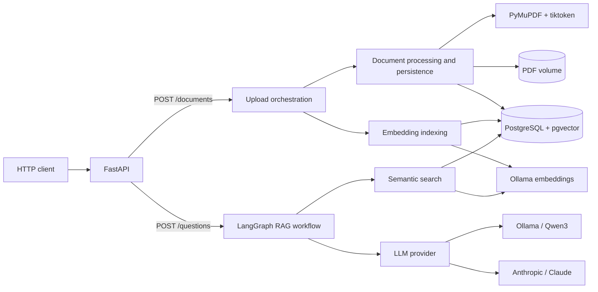
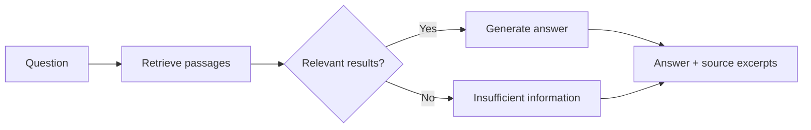

# Garden Center API — Architecture

This document describes the architecture, main design decisions, and operational trade-offs of the Garden Center API. See the [README](../README.md) for setup, configuration, and example requests.

## Components and data flow



PDF upload validates the file, extracts page-aware text, creates token-bounded chunks, stores the original PDF through `FileStorage`, and indexes chunk embeddings in PostgreSQL. The current `LocalFileStorage` adapter writes PDFs to a persistent Docker volume; metadata, chunks, processing status, and vectors are stored in PostgreSQL. The document lifecycle API enables documents to be listed with their processing status, inspected with their chunks, and removed with their stored file and index data.

A question is embedded using the same model as the indexed documents. pgvector retrieves compatible chunks by cosine similarity, subject to the configured relevance threshold. The LangGraph workflow uses these excerpts to generate a grounded answer and returns their document, page, and chunk metadata.

## Module boundaries

| Package | Responsibility |
| --- | --- |
| `api/` | Routes, validation, response models, dependency wiring, and rate limiting |
| `documents/` | PDF processing and document lifecycle |
| `rag/` | Chunk indexing, semantic retrieval, context selection, and LangGraph orchestration |
| `ai/` | Embedding and generation provider protocols and implementations |
| `database/` | SQLAlchemy models (`models.py`) and async engine/session lifecycle (`engine.py`) |
| `storage/` | File storage contract (`file_storage.py`) and local filesystem adapter (`local_file_storage.py`) |
| `core/` | Configuration and concurrency limits |
| `observability/` | Optional OpenTelemetry setup and instrumentation |

Provider-specific HTTP details stay in `ai/`. The document service depends on the `FileStorage` protocol rather than `LocalFileStorage`; dependency wiring in `api/` selects the local adapter. Likewise, `EmbeddingProvider` and `LLMProvider` allow the application to use test doubles without changing business logic. Only an Ollama embedding implementation is currently provided; generation supports Ollama and Anthropic.

## LangGraph question workflow



The graph is compiled once per API process. Each invocation receives its own database session, provider instances, and configuration through LangGraph runtime context; request-specific state is not shared.

Retrieved excerpts are selected in descending similarity order within a configurable context-token budget that reserves space for the system prompt, question, formatting, and response. `tiktoken` provides an estimate, not the exact token count of every supported LLM.

The LLM is instructed to answer only from retrieved passages and to treat document content as untrusted data. Structured `sources` identify excerpts **supplied to the model**, not independently verified passages used in its final reasoning. When no result passes the relevance threshold, the graph returns a fallback without calling the generation model.

## Key design decisions

| Decision | Benefit | Trade-off |
| --- | --- | --- |
| **Synchronous upload and indexing** | HTTP 201 means indexing completed and the document is searchable | Upload latency depends on PDF size and Ollama availability |
| **PostgreSQL + pgvector** | One durable database for metadata, chunks, and vectors | No ANN index; linear vector search is appropriate only at the current small scale |
| **Page-bounded token chunks** | Reproducible ordering and identifiable page sources | Related content across a page boundary may be split |
| **Embedding compatibility filtering** | Prevents mixing different models or vector dimensions | Changing embedding models requires reindexing existing content |
| **Local Ollama by default** | Fully working mode without paid API keys | CPU-only inference can be slow; local hardware limits throughput |
| **Optional Anthropic generation** | Higher-quality hosted generation can be selected by configuration | Paid API and internet connection required; embeddings remain local |
| **Document lifecycle API** | Makes ingestion reproducible and its persisted state inspectable and removable | Adds API surface beyond the minimum RAG requirements |

## Concurrency and scalability

**Implemented today.** FastAPI, SQLAlchemy/psycopg, and provider HTTP calls use asynchronous I/O. Database sessions and LangGraph invocation context are request-scoped. Blocking PDF extraction, tokenization, and filesystem operations are offloaded from the event loop. Connection pooling, upload-size/page limits, model timeouts, and per-IP rate limits bound resource usage.

Generation concurrency is limited per API process: Ollama defaults to two concurrent calls; Anthropic has no application-level limit by default. When generation capacity is full, an incoming request is rejected rather than queued. Both generation limits and rate-limit counters are process-local, not coordinated across workers. The local LLM is the likely performance bottleneck.

**If usage grows**, the implementation would be evolved in this order:

1. Measure request latency, Ollama latency/errors, embedding throughput, database pool usage, and event-loop delays.
2. Add shared rate limiting and explicit limits for concurrent embedding work where measurements justify them.
3. Move long-running PDF indexing to durable background workers with visible job states and recovery.
4. Scale API instances against shared PostgreSQL and shared file/object storage.
5. Consider a pgvector ANN index only when corpus size and query plans justify it.

These are possible future improvements, **not implemented features or requirements of the take-home assignment**. Large-scale load testing is intentionally out of scope.

## Failure handling and document lifecycle

- API validation and provider failures return structured errors with appropriate HTTP status codes. The `/health` endpoint checks process liveness; `/ready` checks PostgreSQL, not Ollama model availability.
- Uploads use content-hash duplicate detection. Files are written atomically within the local filesystem, and failure paths attempt to clean up both database records and stored PDFs.
- `processing` documents are excluded from retrieval. Embeddings and `completed` status are committed together, so incomplete indexing cannot become searchable.
- PostgreSQL transactions and filesystem writes cannot be committed atomically. An interrupted process can therefore leave a stale `processing` document and PDF; this is a documented limitation rather than an automatic recovery workflow.

To inspect `processing` records older than one hour:

```bash
docker compose exec db psql -U garden_center -d garden_center -c \
  "SELECT id, filename, created_at FROM documents WHERE processing_status = 'processing' AND created_at < now() - interval '1 hour';"
```

After confirming that the upload is no longer active, remove the document via the existing `DELETE /api/v1/documents/{id}` endpoint. Do not delete the database row directly, as that can leave an orphaned PDF.

## Observability and limitations

OpenTelemetry is optional and disabled by default. When enabled, it traces HTTP requests and LangGraph execution, including retrieval and generation metrics. Prompt text, document excerpts, answers, and credentials are excluded from exported telemetry.

The prototype does not support OCR/scanned or encrypted PDFs, authentication, tenant isolation, durable background indexing, distributed rate limiting, or shared object storage. There is no automatic stale-index recovery or comprehensive RAG evaluation framework. These limitations are intentional and consistent with the assignment's focus on a small, reproducible backend.
