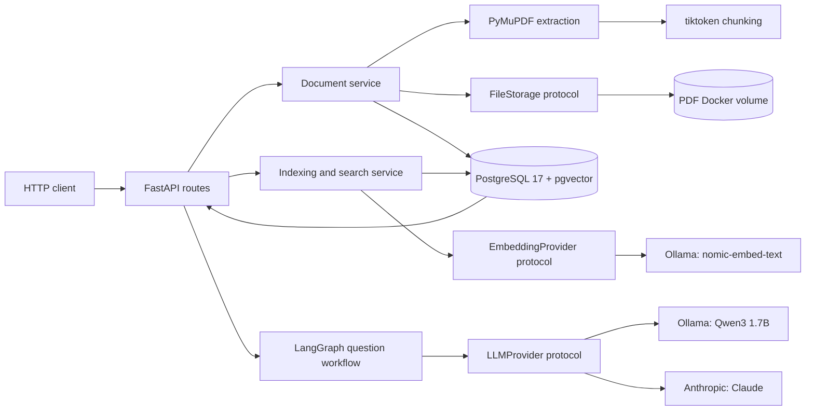
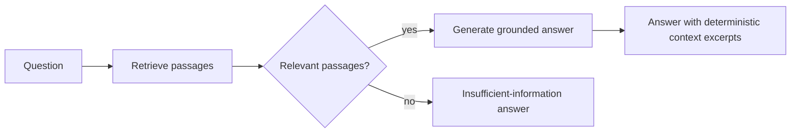

# Garden Center API architecture

This document describes the implementation as it exists today. The system is a
flower-gardening document ingestion, semantic retrieval, and grounded
question-answering service.

## Components and data flow



Uploads pass through validation, extraction, normalization, token-aware
chunking, database persistence, batched embedding, and vector persistence in a
synchronous request. Search embeds the query, filters stored vectors by
provider/model/dimensions, and uses pgvector cosine distance. Results retain the
document ID, filename, source page, chunk index, and source text.

The original PDF is stored in a persistent Docker volume rather than the
database. PostgreSQL stores its provider-generated storage key alongside the
metadata, extracted chunks, lifecycle status, and embeddings. Foreign keys and
ORM cascades remove chunks and embeddings with their parent document.

## Layering and provider boundaries

- `routes/` owns HTTP validation, status codes, and response schemas.
- `document_service.py` coordinates persistence and file lifecycle.
- `file_storage.py` generates provider-owned storage keys and isolates generic
  filesystem access behind the small `FileStorage` protocol. The document
  service supplies only the logical directory, media type, and extension.
- `document_processing.py` contains persistence-independent PDF extraction and
  chunking.
- `search_service.py` owns automatic upload indexing and semantic retrieval.
- `embeddings.py` defines the `EmbeddingProvider` protocol and isolates Ollama
  HTTP behavior.
- `models.py` and `database.py` own SQLAlchemy models, async sessions, and engine
  lifecycle.
- `config.py` provides validated environment configuration through
  pydantic-settings.

Only `OllamaEmbeddingProvider` is implemented. Dependency injection allows tests
to replace it with deterministic or failing fakes without mocking application
internals.

### LangGraph and generation providers

The question endpoint runs an explicit LangGraph state graph:



`LLMProvider` isolates local Qwen3 generation from Anthropic Claude. Provider
selection affects generation only: query and document embeddings always use
the configured Ollama embedding model. Context metadata is built from retrieval
results rather than model output. It identifies the excerpts provided to the
model, not which excerpts the model actually used. The prompt restricts
generation to those excerpts and requests a clean answer without inline citations.
The graph is built and compiled once per API process. Each invocation supplies
its request-scoped database session, providers, and search/token configuration
through LangGraph's runtime context, so concurrent runs reuse only the immutable
workflow definition and never share a database session.
Retrieved chunks are added by descending similarity within a configurable token
budget that reserves room for prompt framing and output. The `tiktoken` count is
an estimate and may differ from the generation provider's native tokenizer.
Grounding rules are sent through Anthropic's native `system` field and Ollama's
chat `system` role; questions and excerpts remain in the separate user message.

OpenTelemetry tracing is optional and disabled by default. FastAPI automatic
instrumentation creates the request span, and OpenInference's LangChain
instrumentation creates the LangGraph workflow and node spans from its callback
events. Small telemetry helpers add counts, token-budget utilization,
provider/model, and provider-reported token usage to the active node span without
placing telemetry fields in `QuestionState`. Automatic input/output capture is
masked, so questions, workflow state, document excerpts, generated answers, and
credentials are not exported. This avoids duplicate manual workflow/node spans;
the console exporter keeps the local setup self-contained and is shut down with
the application.

## Key decisions and trade-offs

**Synchronous upload and indexing.** A successful HTTP 201 guarantees that the
document is searchable. This provides simple, strong semantics, but request
latency and timeout risk grow with document size and Ollama load.

**PostgreSQL as shared state.** Async SQLAlchemy and pgvector keep metadata,
chunks, and vectors transactional and available to multiple API instances. This
avoids a separate vector database for a small take-home project.

**Dimension-flexible vector column.** Each embedding records provider, model,
and dimensions. Database constraints validate dimensions, while search filters
to one compatible embedding space. This permits future models with different
dimensions without mixing incompatible vectors.

**Deterministic, page-bounded chunks.** Token-aware chunks preserve page
references and stable ordering. Page boundaries improve citations but may lose
context spanning adjacent pages.

**Local-first model integration.** Ollama makes indexing reproducible without a
paid API. It also makes throughput dependent on local CPU/GPU and model
availability.

**Offset pagination.** Document lists are simple and predictable for this data
size. Cursor pagination would be preferable for very large or frequently
changing collections.

## Concurrency and scalability

FastAPI endpoints, SQLAlchemy sessions, psycopg calls, and Ollama HTTP requests
are async. A fresh database session is injected per request, and request data is
not kept in shared mutable application state. The SQLAlchemy engine owns a
connection pool and is disposed during application shutdown.

PDF extraction, tokenization, and local file operations are blocking or
CPU-heavy work and are moved to a bounded thread-pool operation. Page and
extracted-character limits bound pathological PDFs. Ollama is the likely
throughput bottleneck, and synchronous uploads can occupy API capacity for their
full duration.

For greater load, improvements should be introduced in this order:

1. Measure upload duration, event-loop latency, database pool saturation,
   Ollama latency/error rate, chunk counts, and search latency.
2. Bound concurrent embedding calls and apply request-size/rate limits.
3. Move extraction and indexing to durable workers with explicit queued states,
   while keeping search and health endpoints stateless.
4. Run multiple API instances against shared PostgreSQL and object storage.
5. Add a dimension-specific pgvector ANN index when corpus size and measured
   query plans justify it.

Timeouts already bound Ollama calls. Production hardening would add carefully
bounded retries with jitter for transient failures, load shedding, and separate
worker/API resource limits. Retries must remain idempotent to avoid duplicate
embeddings.

## Error handling and cleanup

API errors use HTTP status codes and structured `detail.code`/`detail.message`
objects for document and embedding operations. Validation failures return 400,
duplicate content returns 409, missing documents return 404, and database or
Ollama failures return 503. FastAPI supplies 422 responses for invalid request
schemas and pagination values.

Document status reflects the indexing lifecycle:

- `processing`: extraction/indexing is in progress;
- `completed`: every chunk has a compatible persisted embedding;

Indexing is part of the synchronous upload flow. A successful `201` therefore
means all chunks have persisted embeddings. Any later processing, provider, or
embedding-persistence failure deletes the document and its cascaded chunks and
vectors, then removes the uploaded file so the same content can be retried.
Embedding batches are flushed within one transaction; their vectors and the
document's `completed` status are committed together. Search excludes documents
that are still marked `processing`.
Local file storage writes a temporary file and uses `os.replace` to publish
each file atomically within the same filesystem. The database and filesystem do
not form one atomic transaction, so explicit cleanup handles failures between
those steps. The unique content hash constraint prevents duplicate documents,
including concurrent identical uploads.

An interrupted process can leave a document in `processing` from before the
indexing transaction completes. To inspect records that are unlikely to belong
to an active synchronous upload, run:

```bash
docker compose exec db psql -U garden_center -d garden_center -c \
  "SELECT id, filename, created_at FROM documents WHERE processing_status = 'processing' AND created_at < now() - interval '1 hour';"
```

After confirming that no upload for a listed document is still running, delete
it through `DELETE /api/v1/documents/{id}`. Using the API removes both database
data and the stored file; deleting the row directly can leave an orphaned file.

The liveness endpoint deliberately ignores dependencies. Readiness checks
PostgreSQL only; it does not currently verify Ollama or model installation.

## Delivery status

Implemented:

- Dockerized Python 3.14 API, PostgreSQL/pgvector, and Ollama;
- automatic Alembic migration at startup;
- PDF validation, extraction, normalization, chunking, and persistent storage;
- document CRUD with pagination, duplicate detection, and cascade deletion;
- automatic embedding indexing during upload with failure cleanup;
- cosine-similarity retrieval with source metadata;
- LangGraph retrieval/relevance/generation workflow with deterministic context;
- configurable local Qwen3 or Anthropic Claude answer generation;
- optional OpenTelemetry request and RAG tracing to Docker console output;
- focused unit and real-PostgreSQL integration tests;
- health, readiness, structured errors, and local sample data.

Known limitations:

- no OCR, scanned/encrypted PDF support, authentication, or tenant isolation;
- processing is synchronous and has no durable job queue;
- readiness does not include Ollama;
- no retry policy, rate limiting, metrics backend, or ANN vector index;
- uploaded files use a node-local Docker volume rather than shared object
  storage.

The highest-value next step would be evaluating retrieval thresholds and answer
groundedness against a small representative question set before adding more
workflow complexity.
